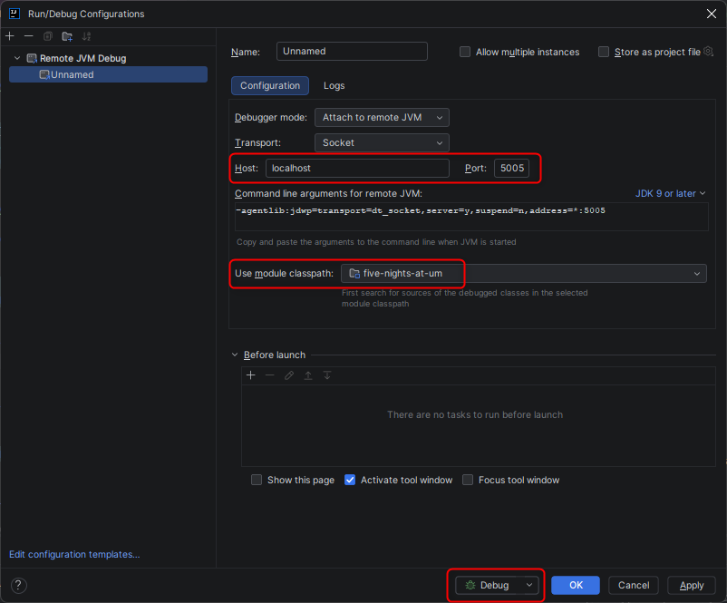
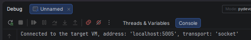
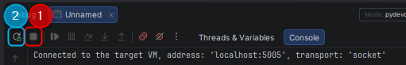
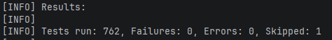

# Los libros de Buysan
Repositorio para el proyecto de la materia Desarrollo Seguro

## ¿Cómo levantar el proyecto?

Requisitos: Docker Desktop instalado y corriendo.

### 1. Variables de entorno

Copie `.env.example` a `.env` en la raíz del repo y complete con los valores del archivo proporcionado en la entrega nro. 3

### 2. Levantar el stack

```bash
docker compose up --build -d
```

Esto levanta tres contenedores:

| Servicio | Puerto | URL                                                                                                                                                 |
|---|---|-----------------------------------------------------------------------------------------------------------------------------------------------------|
| Frontend | 5173 | http://localhost:5173                                                                                                                               |
| Backend | 8080 | http://localhost:8080                                                                                                                               |
| Postgres | 5445 (configurable con `DB_PORT` en `.env`) | `localhost:5445` (expuesto solo para desarrollo local, ej. conectar con DBeaver). Si ese puerto tambien esta ocupado, cambie `DB_PORT` en su `.env`. |

### 3. Datos de prueba

La primera vez que arranca contra una base vacía, el backend carga automáticamente:
- 3 librerías de prueba (2 habilitadas: "Libreria Central" y "Libreria Norte"; 1 deshabilitada: "Libreria Dada de Baja"), cada una con su propio catálogo completo de 202 libros (606 libros en total).
- Los libros de la librería deshabilitada sirven para probar que dejan de verse en catálogo/búsqueda/detalle sin borrarse de la base.
- A futuro esto se implementara de otra manera (dueño carga el CSV de los libros - aún no implementado)
 
Para usar funcionalidades de comprador (favoritos, etc.) hay que registrar un usuario:

```bash
curl -X POST http://localhost:8080/api/auth/register \
  -H "Content-Type: application/json" \
  -d '{"username":"tu_usuario","email":"tu@email.com","password":"tu_password"}'
```

### 4. Cuenta de administrador (R18)

No existe registro público de dueños ni de administradores. La cuenta de administrador se crea por seed la primera vez que el backend arranca sin ningún admin, con estas variables del `.env`:

```
ADMIN_USERNAME=admin
ADMIN_EMAIL=admin@librosbuysan.local
ADMIN_INITIAL_PASSWORD=<8 a 64 caracteres>
```

- Si falta alguna, no se crea el admin (se avisa en el log). Si están mal formadas, el backend no arranca.
- Una vez creado, las variables se ignoran: la contraseña se cambia desde el panel de administrador.
- El admin entra por el login común y el frontend lo lleva a su panel, donde solo puede crear dueños (cada uno con su librería; se muestra una contraseña temporal una única vez) y cambiar su propia contraseña.
- El dueño creado debe cambiar la contraseña temporal en su primer inicio de sesión; hasta entonces su token solo permite eso.

### 5. Reiniciar desde cero

Si cambia el modelo de datos y hace falta recrear la base:

```bash
docker compose down -v   # borra tambien el volumen de Postgres
docker compose up --build -d
```

## ¿Cómo debuguear el backend desde IntelliJ?

El servicio `backend` arranca con el agente JDWP de Java escuchando en el puerto **5005** (configurado en `docker-compose.yml` con `JAVA_TOOL_OPTIONS`). Así, IntelliJ se conecta al contenedor y se puede frenar en breakpoints mientras se usa el frontend en http://localhost:5173.

### 1. Levantar el stack

```bash
docker compose up --build -d
```

### 2. Poner breakpoints
Abrir el archivo que guste seguir, coloque el breakpoint **dentro del cuerpo del método**, no en la línea de la firma (`public ... search(...)`).

### 3. Crear la configuración de debug en IntelliJ
1. Menú **Run → Edit Configurations...**
2. **+** → **Remote JVM Debug**
3. Configurar:
   - **Host:** `localhost`
   - **Port:** `5005`
   - **Use module classpath:** dejar el default
4. Seleccionar el botón de debug.
5. En la consola de Debug tiene que aparecer **Connected to the target VM**.





### 5. Probarlo desde el navegador

1. Entrá a http://localhost:5173.
2. Realice la operación que espera que el breakpoint pare.

### Problemas comunes

- **No aparece "Connected to the target VM":** verificá que el contenedor esté arriba (`docker compose ps`) y que el puerto 5005 esté publicado. Si el puerto está ocupado, cambialo en `docker-compose.yml`.
- **Actualizó los breakpoints:** seleccione el "stop" de la consola de debug y luego el "Rerun"



## ¿Cómo correr los test unitarios y de integración?

Para correrlo por primera vez debe ejecutar el siguiente comando en la terminal, ¡Debe tener el programa corriendo en Docker! 

```bash
 docker compose run --rm --build test
```

Luego, si precisa volverlo a ejecutar puede evitar el `--build`
```bash
 docker compose run --rm test
```

> Si realiza algun cambio en los escenarios de test, debe volver a ejecutar el primer comando, para que considere sus cambios


Debe considerar el resultado final, no se "deja llevar" por los comentarios que aparecen en algunas líneas como "inválido" o "duplicado", esos en general son los resultados esperados:

_Ejemplo de resultado de la ejecución:_


## ¿Cómo ejecutar el Dependency-Check?

[OWASP Dependency-Check](https://owasp.org/www-project-dependency-check/) analiza las dependencias del proyecto y genera un reporte con las vulnerabilidades conocidas (CVE).

> Dependency-Check **no descarga dependencias por sí solo**: analiza lo que hay físicamente en las carpetas que se le indican. Por eso, antes de escanear hay que dejar las dependencias del backend en una carpeta del proyecto (paso 2). Si no, el reporte sale vacío aunque haya vulnerabilidades.

### Requisitos

- **Java** instalado (`java -version`).
- **Maven** instalado y agregado al `PATH` (`mvn -v`). Si no lo reconoce, descárguelo de https://maven.apache.org/download.cgi, descomprímalo y agregue su carpeta `bin` al `PATH` (por ejemplo `C:\apache-maven-3.10.0\bin`). Abra una consola nueva para que tome el cambio.
- **Dependency-Check** descargado y descomprimido (por ejemplo en `C:\dependency-check`), desde https://owasp.org/www-project-dependency-check/.
- Una **API key de NVD** (gratuita, se solicita en https://nvd.nist.gov/developers/request-an-api-key). Sin ella la primera ejecución es muy lenta. **No suba la key al repositorio ni la comparta en capturas.**
- Dependencias del frontend instaladas (`npm install` en `frontend/`), para que exista `node_modules`.

### 1. Ubicarse en el backend

```bat
cd <ruta-del-repo>\backend
```

### 2. Descargar las dependencias del backend

```bat
mvn dependency:copy-dependencies -DoutputDirectory=target\deps
```

Este comando copia todos los `.jar` del backend (incluidas las dependencias transitivas) a `backend\target\deps`. Espere a que termine con `BUILD SUCCESS` y verifique que la carpeta tenga archivos `.jar`:

```bat
dir target\deps
```

En PowerShell las comillas son necesarias: `mvn dependency:copy-dependencies "-DoutputDirectory=target\deps"`.

### 3. Generar el reporte

Desde la carpeta `bin` de Dependency-Check:

```bat
cd C:\dependency-check\bin
dependency-check.bat --project "Libreria Buysan" --scan "C:\Desarrollo\DS\five-nights-at-um" --format ALL --out "C:\Desarrollo\DS\reporte-dc" --disableYarnAudit --disableCentral --nvdApiKey <SU_API_KEY>
```

| Parámetro | Qué hace |
|---|---|
| `--project` | Nombre que aparece en el reporte. |
| `--scan` | Carpeta a analizar: la raíz del repo (incluye `frontend/node_modules` y `backend/target/deps`). |
| `--format ALL` | Genera el reporte en todos los formatos (HTML, JSON, XML, CSV, etc.). |
| `--out` | Carpeta donde se guardan los reportes. |
| `--disableYarnAudit` | Evita un error: el analizador de Yarn se activa porque hay un `yarn.lock` dentro de `node_modules`, pero el proyecto usa npm. |
| `--disableCentral` | Evita el error de conexión a Maven Central (timeout). |
| `--nvdApiKey` | API key de NVD. |

> **Las rutas de `--scan` y `--out` son de ejemplo:** reemplácelas por la ubicación del proyecto y la carpeta de salida en su máquina. Pueden ser diferentes a las del ejemplo.

La primera ejecución descarga la base de datos NVD y puede tardar bastante: espere a que vuelva el prompt, no la corte.

### 4. Validar el reporte

Abra `dependency-check-report.html` (en la carpeta indicada en `--out`) y verifique:

- En **Scan Information**, **Report Generated On** corresponde a la ejecución reciente.
- **Dependencies Scanned** es alto (miles de archivos) y aparecen los `.jar` del backend (por ejemplo `spring-core-x.x.x.jar`). Si no aparecen, revise el paso 2.
- No aparece la sección **Analysis Exceptions**. Si aparece, el análisis quedó incompleto.
